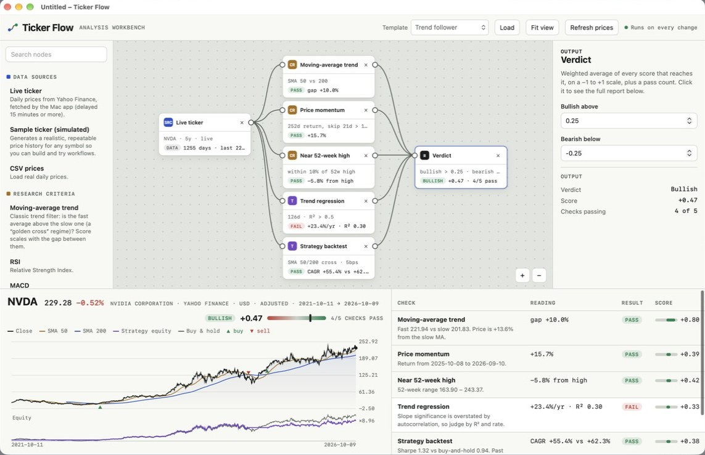

# Ticker Flow for Mac



A node-based stock analysis workbench. Wire a data source into research criteria and statistical tests, add gates for must-pass rules, and read a weighted verdict.

## Build and install

In Terminal, from the project folder, run:

```
bash build.sh
```

You can also double-click **Build Ticker Flow.command**. If macOS opens it as text instead of running it, run `chmod +x "Build Ticker Flow.command" build.sh` once.

The script compiles the app with the Swift compiler that ships with Xcode, installs **Ticker Flow.app** in `~/Applications`, and opens it. It needs macOS 12 or later. If the compiler is missing, run `xcode-select --install`.

## What the Mac app adds

- **Live ticker node**: daily prices from Yahoo Finance (with Stooq as a backup), adjusted for splits and dividends. Press Return after typing a symbol. Use View › Refresh Prices (⌘R) to fetch again.
- **Workflow files** (`.tickerflow`): File › New, Open, Save, Save As. Double-click a saved workflow to open it.
- **Import Price CSV (⌘I)** and **Export Results as CSV (⇧⌘E)**.
- **Templates menu** (⌘1–⌘5).
- Two-finger scroll pans the canvas; pinch or ⌘-scroll zooms; ⌘0 fits the workflow.
- Your current workflow is kept between launches, in `~/Library/Application Support/Ticker Flow/`.

## Project layout

| Path | What it is |
| --- | --- |
| `Sources/TickerFlow.swift` | Native shell: window, menus, files, price downloads |
| `Resources/index.html` | The workbench UI and analysis engine |
| `Resources/Info.plist` | App and document-type settings |
| `Resources/AppIcon.icns` | App icon |
| `build.sh` | Build, sign for this Mac, install, open |

Educational tool, not investment advice. Live prices can be delayed.
